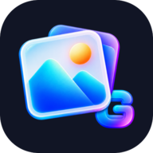
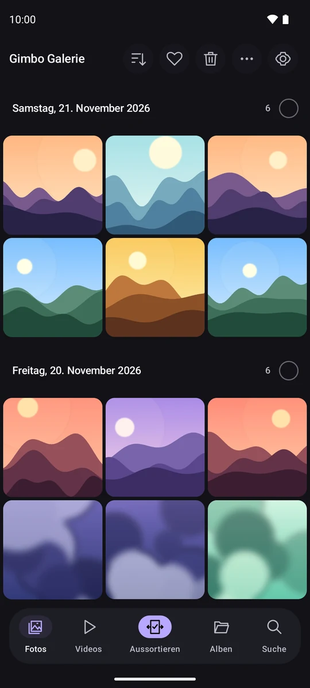
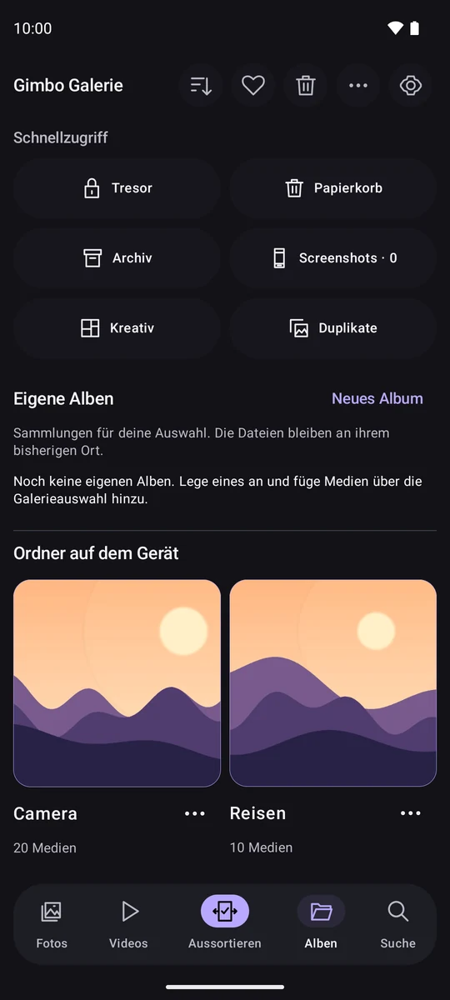
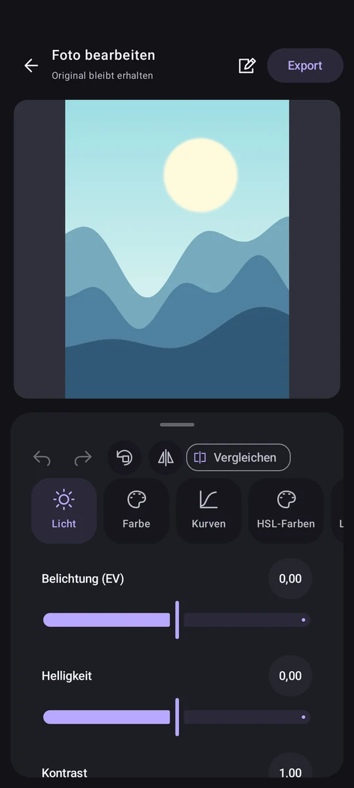
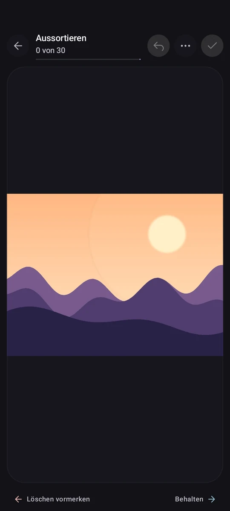

<div align="center">

🇩🇪 <a href="README.md">Deutsch</a> &nbsp;·&nbsp; 🇬🇧 <b>English</b>



# Gimbo Galerie

**Gallery. Editor. Your ideas.**


[**Download APK**](../../releases/latest) · [**All versions**](../../releases) · [**Changelog**](CHANGELOG.en.md)

</div>

---

Local photo and video gallery with a built-in editor. All media stays on your device.

<div align="center">

| Photos | Albums | Editor | Sort through |
| :---: | :---: | :---: | :---: |
|  |  |  |  |

</div>

## Features

| Area | Content |
| :--- | :--- |
| **Gallery** | Zoomable grid, search, favorites, archive, trash, custom albums, device folders |
| **Photo editor** | Crop, filters, tone curves, text, drawing, batch editing |
| **Video editor** | Trimming, multiple clips, music, overlays, export |
| **Extras** | Collages, memories, color moods, duplicates, swipe to sort |
| **Security** | Encrypted vault with device lock, local project backups, optional cloud backup |
| **Languages** | 33 languages, selectable in the app under Settings → Language; German and English complete |

Completely free: no ads, no purchases, no accounts, no telemetry.

## Build

Requirements: JDK 17+, Android SDK 36 with Build Tools 36.0.0, SDK path in `local.properties`.

```sh
./gradlew assembleDebug
./gradlew testDebugUnitTest lintDebug
python3 scripts/package_release.py
```

| Variant | Command |
| :--- | :--- |
| Debug APK | `./gradlew assembleDebug` |
| Release bundle | `./gradlew bundleRelease` |
| Check translations | `python3 scripts/check_translations.py` |

## Project

- App ID: `de.luma.gallery`
- Kotlin, Jetpack Compose, Material 3, Room, WorkManager, Media3

## License and legal

- **License:** [MIT](LICENSE) © 2026 Hiarni
- **Third parties:** [THIRD-PARTY-NOTICES.txt](THIRD-PARTY-NOTICES.txt), license texts in [LICENSES](LICENSES); in the app under Settings → Open-source licenses
- **Privacy:** [PRIVACY.en.md](PRIVACY.en.md)
- Android is a trademark of Google LLC.

<div align="center">

© 2026 Hiarni

</div>
