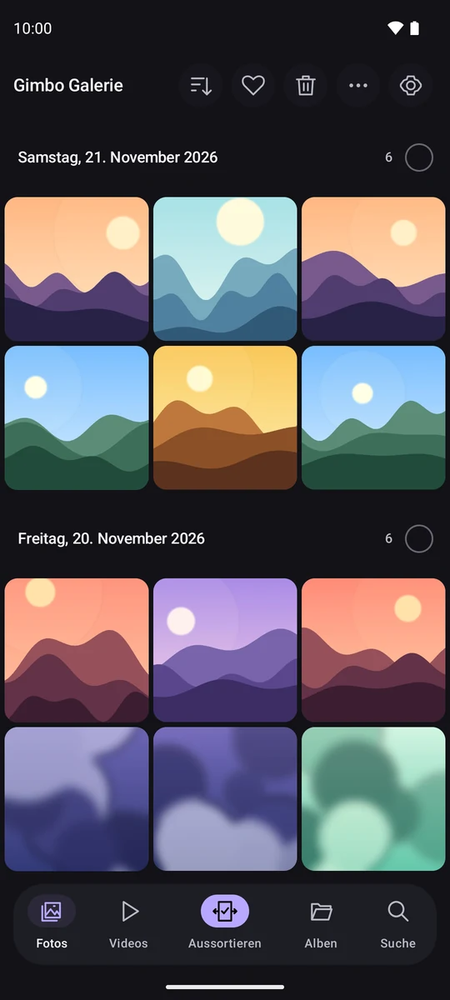
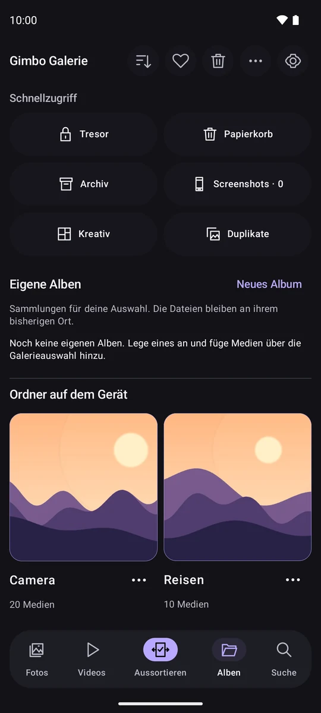
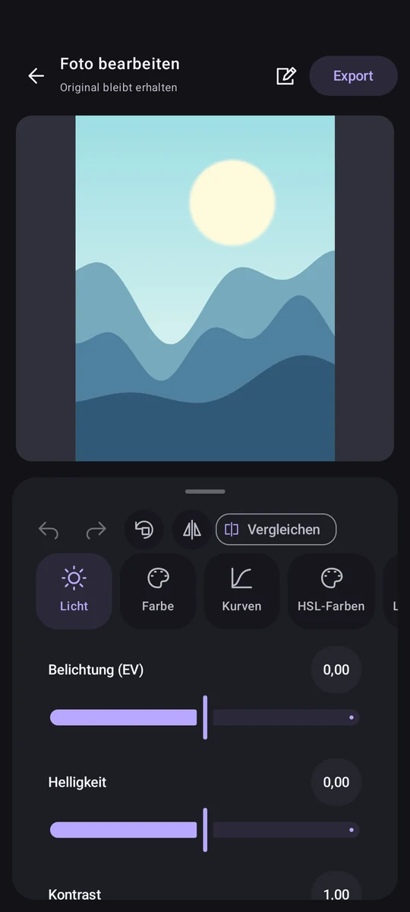
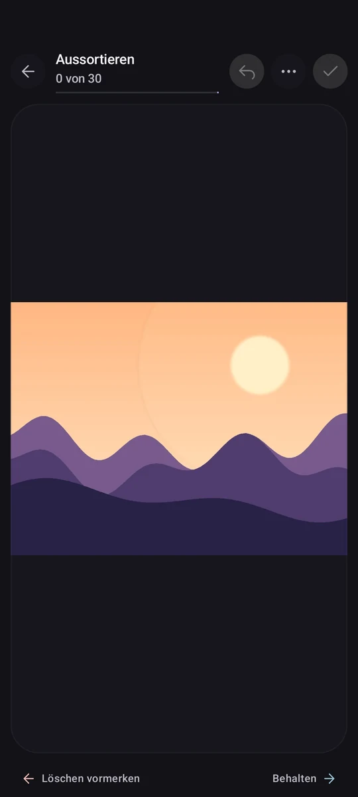

<div align="center">

🇩🇪 <b>Deutsch</b> &nbsp;·&nbsp; 🇬🇧 <a href="README.en.md">English</a>


# Gimbo Galerie

**Galerie. Editor. Deine Ideen.**


[**APK herunterladen**](../../releases/latest) · [**Alle Versionen**](../../releases) · [**Änderungen**](CHANGELOG.md)

</div>

---

Lokale Foto- und Videogalerie mit integriertem Editor. Alle Medien bleiben auf dem Gerät.

<div align="center">

| Fotos | Alben | Editor | Aussortieren |
| :---: | :---: | :---: | :---: |
|  |  |  |  |

</div>

## Funktionen

| Bereich | Inhalt |
| :--- | :--- |
| **Galerie** | Zoombares Raster, Suche, Favoriten, Archiv, Papierkorb, eigene Alben, Geräteordner |
| **Fotoeditor** | Zuschnitt, Filter, Tonwertkurven, Text, Zeichnen, Stapelbearbeitung |
| **Videoeditor** | Schnitt, mehrere Clips, Musik, Overlays, Export |
| **Extras** | Collagen, Erinnerungen, Farbstimmungen, Duplikate, Aussortieren per Wischgeste |
| **Sicherheit** | Verschlüsselter Tresor mit Gerätesperre, lokale Projektsicherungen, optionale Cloudsicherung |
| **Sprachen** | 33 Sprachen, in der App unter Einstellungen → Sprache wählbar; Deutsch und Englisch vollständig |

Komplett kostenlos: keine Werbung, keine Käufe, keine Konten, keine Telemetrie.

## Bauen

Voraussetzungen: JDK 17+, Android SDK 36 mit Build Tools 36.0.0, SDK-Pfad in `local.properties`.

```sh
./gradlew assembleDebug
./gradlew testDebugUnitTest lintDebug
python3 scripts/package_release.py
```

| Variante | Befehl |
| :--- | :--- |
| Debug-APK | `./gradlew assembleDebug` |
| Release-Bundle | `./gradlew bundleRelease` |
| Übersetzungen prüfen | `python3 scripts/check_translations.py` |

## Projekt

- App-ID: `de.luma.gallery`
- Kotlin, Jetpack Compose, Material 3, Room, WorkManager, Media3

## Lizenz und Rechtliches

- **Lizenz:** [MIT](LICENSE) © 2026 Hiarni
- **Drittanbieter:** [THIRD-PARTY-NOTICES.txt](THIRD-PARTY-NOTICES.txt), Lizenztexte in [LICENSES](LICENSES); in der App unter Einstellungen → Open-Source-Lizenzen
- **Datenschutz:** [PRIVACY.md](PRIVACY.md)
- Android ist eine Marke von Google LLC.

<div align="center">

© 2026 Hiarni

</div>
